<a href="https://github.com/tbsrgt">
  
</a>

<a href="https://github.com/tbsrgt/france-mcp">
  
</a>

<a href="https://github.com/tbsrgt/france-mcp"></a><a href="https://github.com/tbsrgt/claude-ovh-dns"></a><a href="https://github.com/tbsrgt/mue"></a>

<a href="https://oculot.studio"></a><a href="https://oculot.studio"></a>

<a href="https://tobiasringot.vercel.app">
  
</a>

<a href="https://nulll.club"></a><a href="https://ooone.vercel.app"></a>

<a href="https://github.com/tbsrgt">
  
</a>

  
  
  
  <a href="https://www.instagram.com/tbsrgt/">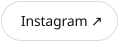</a>
  

